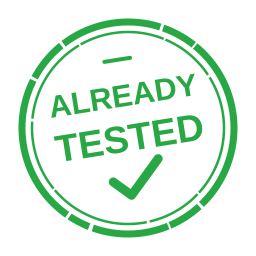

# already-tested

[](https://github.com/dblock/already-tested/actions/workflows/test.yml) [](https://github.com/dblock/already-tested/actions/workflows/coverage.yml) [](https://github.com/dblock/already-tested/actions/workflows/lint.yml) [](https://github.com/dblock/already-tested/actions/workflows/package.yml)

Skip duplicate CI when a trusted local run matches the committed source and workflow. **Claims are not proof that tests ran.**

Native Rust binaries for Linux, macOS, and Windows, on x86_64 and ARM64. Git must be available; no Node, npm, or Rust runtime is needed.

## Installation

Unreleased: release downloads become available after the first GitHub Release. Meanwhile, download your platform archive and checksum from the Package workflow, or build with `cargo build --release`.

The installers select your platform and verify the archive checksum before replacing the executable:

```sh
curl -fsSL https://raw.githubusercontent.com/dblock/already-tested/master/scripts/install.sh | sh
```

On Windows, download and run [install.ps1](scripts/install.ps1). Both installers default to `~/.local/bin`; add it to PATH if needed. See [installation options](DESIGN.md#binary-distribution) for pinned versions and local CI artifacts.

## Usage

Use your project's existing checks, in any language:

1. Run the complete CI check locally in its matching environment.
2. Commit exactly that tested source.
3. Generate a claim and paste the **entire output** into the PR description:

```sh
already-tested claim --workflow .github/workflows/test.yml --check test-linux \
  --command './script/ci' --environment '<actual toolchain versions and OS>'
```

Output is an expandable check such as `test-linux - passed`, with validation details, the commit, content SHA-256, and a hidden machine-readable claim. Regenerate after source or workflow changes; the CLI records your command/environment but never runs or verifies them.

Add the gate after depth-2 checkout and before your setup/test steps:

```yaml
on:
  pull_request:
    types: [opened, synchronize, reopened, edited]
jobs:
  test:
    runs-on: ubuntu-latest
    steps:
      - uses: actions/checkout@v7.0.1
        with:
          fetch-depth: 2
          persist-credentials: false
      - uses: dblock/already-tested@master
        id: tested
        with:
          check: test-linux
      - if: steps.tested.outputs.skip != 'true'
        run: ./script/ci
```

Replace `./script/ci` with your actual command and condition setup/install steps too. Use distinct check IDs for different jobs/environments. Missing, stale, invalid, or unavailable claims/binaries run normal CI. The workflow still produces its required check. Pin a reviewed Action commit for production.

## Configuration

Default: all tracked files plus the workflow. Optional Git pathspec filters must match on the CLI and Action. Anyone who can edit the PR description can forge claims; keep independent checks for external state, platforms, and integration.

See [CLI options, filters, protocol, and limitations](DESIGN.md). The Action selects its platform binary automatically; until a release is published it conservatively runs normal CI.

## Contributing

[Contributing](CONTRIBUTING.md) | [Design](DESIGN.md) | [Changelog](CHANGELOG.md) | [Releasing](RELEASING.md) | [Agent Instructions](AGENTS.md). The original JavaScript implementation is [already-tested-js](https://github.com/dblock/already-tested-js).

## License

[MIT](LICENSE).
